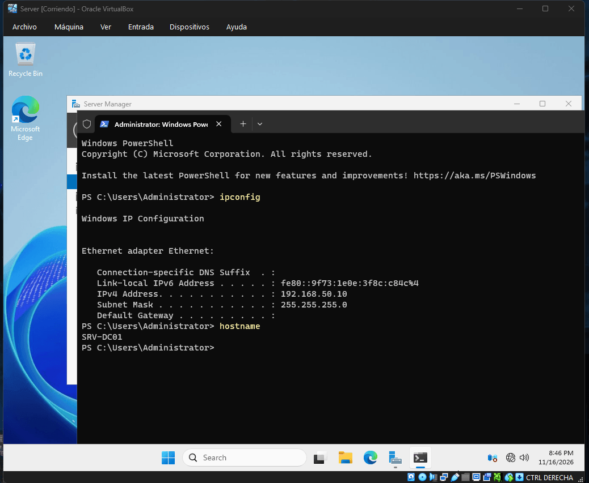
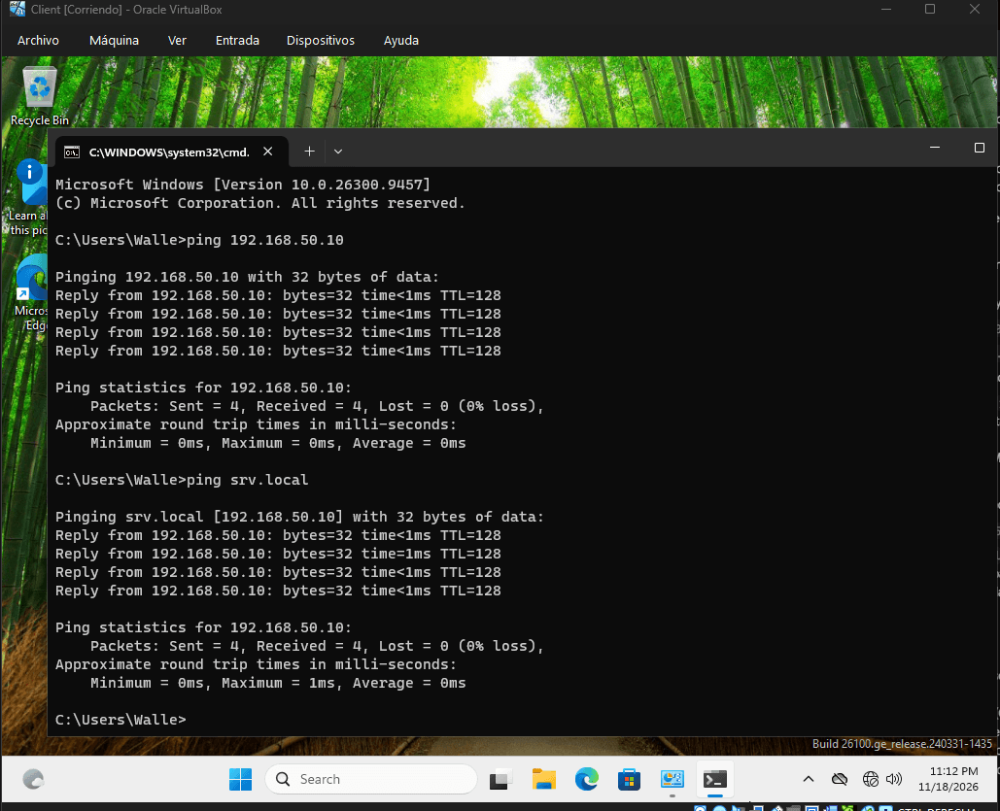

# 01 - Active Directory

La Arquitectura del laboratorio es la siguiente:

2 VMs (VirtualBox) Configuradas en Red Interna para simular un entorno aislado:
**SRV-DC01** (Windows Server 2025, IP estática **192.168.50.10**, dominio **srv.local**) y el **Cliente** Windows 11 Enterprise (**192.168.50.20**, apuntando al DNS del servidor)

Capturas

---
La Estructura y Gobernanza en este laboratorio fue separar a los usuarios en Unidades Organizativas para gestionar controles de acceso y aplicar controles preventivos.
**Support_TI** para una cuenta (**f.ramos**) nivel Administrador en **Domain Admins**
